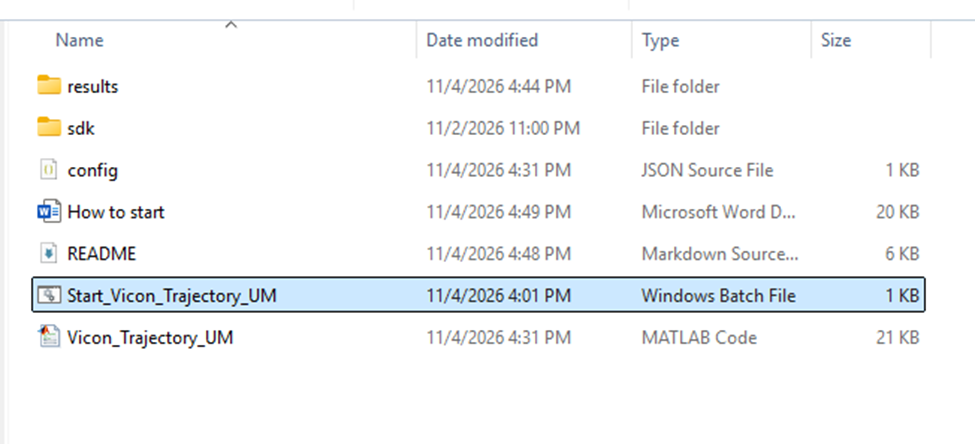
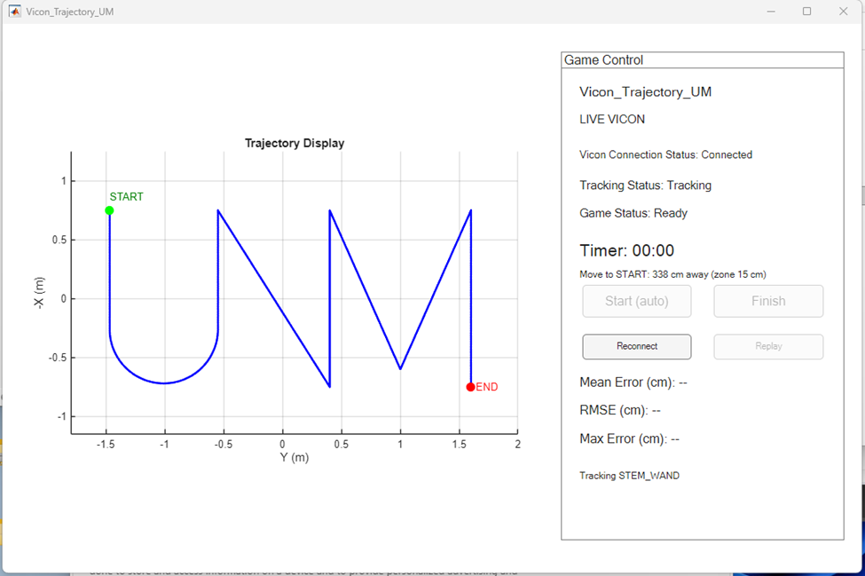
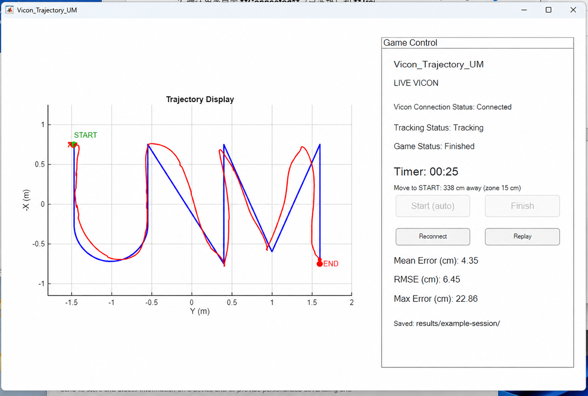

<h1 align="center">Vicon_Trajectory_UM</h1>

<p align="center"><strong>Turn motion capture into a game you can play.</strong></p>
<p align="center">Follow a floor path with a tracked wand.<br>Watch your movement replay, then see how closely you followed the route.</p>
<p align="center"><strong>English</strong> · <a href="README.zh-CN.md">简体中文</a></p>

<p align="center">
  
  
  
</p>

<p align="center">
  <a href="#why-try-it">Highlights</a> · <a href="#see-how-it-plays">Gameplay</a> ·
  <a href="#try-it">Try it</a> · <a href="#bring-it-to-your-lab">Lab setup</a> ·
  <a href="docs/SETUP.md">Documentation</a>
</p>

**Vicon_Trajectory_UM** is a MATLAB game for laboratory demonstrations and student activities. A Vicon system tracks a marker-equipped wand as you follow a blue reference path. When you finish, your movement appears as a red replay, with three distance-error measurements alongside it.

**No Vicon system at hand?** The included simulation runs the entire game on a Windows computer with MATLAB.

## Why try?

<table>
  <tr>
    <td width="50%" valign="top"><strong>🎯 Walk up and play</strong><br><br>Enter the start area, wait for the countdown, and move. Reaching the end finishes the round automatically.</td>
    <td width="50%" valign="top"><strong>▶️ See your movement unfold</strong><br><br>Replay the route in the order and timing you recorded it. Compare the red trail with the blue reference, then watch it again.</td>
  </tr>
  <tr>
    <td width="50%" valign="top"><strong>📏 Put a number on the deviation</strong><br><br>View average, root mean square, and maximum error in centimetres. Each round saves data and a result image.</td>
    <td width="50%" valign="top"><strong>🧪 Try the full experience first</strong><br><br>Simulation is enabled by default. Explore the countdown, recording, replay, and tracking-loss behavior before connecting hardware.</td>
  </tr>
</table>

## See how it plays

**Approach START → Count down → Follow the path → Reach END → Replay & review**

1. **Open the game.** Double-click `Start_Vicon_Trajectory_UM.bat`. The game opens after MATLAB loads.

   

2. **Get ready.** In a live session, check for **LIVE VICON**, **Connected**, and **Tracking**. The downloadable project's default is **SIMULATION MODE**.

   

3. **Step into the start area.** Keep the wand's rigid body origin within **15 cm of START**. After **3 seconds**, recording begins automatically. Leaving the area or losing tracking resets the countdown.

4. **Trace the blue route.** Stay within **15 cm of END** with valid tracking for **0.3 seconds** to finish the round and start the replay.

5. **Watch, compare, repeat.** Review the red trail and error values. Click **Replay** to watch again, or return to START for another live round. In simulation, **Reconnect** resets the wand to START.

   

   <sub>The first screenshot shows an earlier folder layout. The result illustration is based on a recorded screenshot, with an AI-edited save path for privacy.</sub>

### What does a round tell you?

| Mean Error | RMSE | Max Error |
| :--- | :--- | :--- |
| Your average distance from the path. | A measure that gives more weight to large deviations. | Your largest distance from the path. |

All three use the shortest distance to the reference path, in **centimetres**. Smaller means closer. They do not check route order or whether every section was completed. Missing tracking appears as gaps and is excluded from the calculation.

Each round saves **CSV samples**, a **PNG result image**, and a **MAT session** in its own folder. Keep the result for a demonstration or inspect the data in MATLAB later.

## Try it

**You need Windows x64 and MATLAB.** Development and workflow testing used MATLAB R2025b.

Download the repository with **Code → Download ZIP**, extract it, and double-click [Start_Vicon_Trajectory_UM.bat](Start_Vicon_Trajectory_UM.bat). Simulation is already enabled in [config.json](config.json).

Prefer the MATLAB command window? Open the project folder and run:

```matlab
Vicon_Trajectory_UM
```

The simulated wand follows the route in about **20 seconds**, plus countdown and replay time. A short tracking-loss interval is included so you can see how gaps are handled. Click **Reconnect** after the round to try again.

> [!TIP]
> To end a recording early, click **Finish**. Let the replay complete before closing so all output files are saved. Closing the game also exits the MATLAB session opened by the BAT launcher.

## Bring it to your lab

### Hardware

- A calibrated **Vicon camera system** covering the route, with its usual network and power equipment.
- A **rigid handheld wand with reflective markers**, defined as a rigid body in Tracker.
- A **marked floor route**, placed at the reference coordinates in the capture area.
- A Windows x64 computer running MATLAB, with network access to Tracker if it runs on a separate computer.

### Software

| Component | Project setup | Official source |
| --- | --- | --- |
| MATLAB | **R2025b** | [MATLAB](https://www.mathworks.com/products/matlab.html) |
| Vicon Tracker | **3.10.0** | [Tracker](https://www.vicon.com/software/tracker/) |
| Vicon DataStream SDK | **1.11.0**, Windows x64 .NET package | [DataStream SDK](https://www.vicon.com/software/datastream-sdk/) |
| .NET Framework C# compiler | `Framework64\v4.0.30319\csc.exe` | Builds the acquisition adapter locally. |

Tracker and SDK versions above are the maintainer's reported hardware setup. Other combinations have not been comprehensively validated; official sites may feature newer releases. Install MATLAB and Vicon software separately.

### Switch to live tracking

1. Calibrate the Vicon system, create the wand rigid body, and enable **DataStream output** in Tracker.
2. In [config.json](config.json), set `SIMULATION_MODE` to `false` and check `VICON_SERVER`, `RIGID_BODY_NAME`, and `SDK_DIR`. Defaults are `localhost` and `STEM_WAND`.
3. Restart and wait for **Connected** and **Tracking**. The first live run compiles the C# adapter automatically; the project folder must be writable.

> [!IMPORTANT]
> Detection uses the **rigid body origin**, not the wand tip. Match the floor route to the Vicon global XY coordinates. The display uses **horizontal Y / vertical −X**, while data retains the original XY coordinates. No automatic alignment or tip offset is applied.

**[Read the complete setup guide →](docs/SETUP.md)**

## Customize and explore

Defaults: **15 cm** start radius, **3-second** countdown, **15 cm** finish radius, and **0.3-second** finish hold. Edit [config.json](config.json), then restart.

| I want to… | Read this |
| --- | --- |
| Install dependencies and connect Tracker | [Environment and setup](docs/SETUP.md#requirements) |
| Lay out or change the floor route | [Live setup and reference coordinates](docs/SETUP.md#live-vicon-setup) |
| Adjust detection, replay, or simulation | [Configuration reference](docs/SETUP.md#configuration) |
| Understand timestamps and saved files | [Data export](docs/SETUP.md#data-export) |
| Find the source files | [Project structure](docs/SETUP.md#project-structure) |
| Resolve connection or launch problems | [Troubleshooting](docs/SETUP.md#troubleshooting) |

The game runs from MATLAB source. No MATLAB Compiler, separate MATLAB Runtime, Parallel Computing Toolbox, or Python is required. Generated recordings and the adapter DLL are excluded by `.gitignore`.
