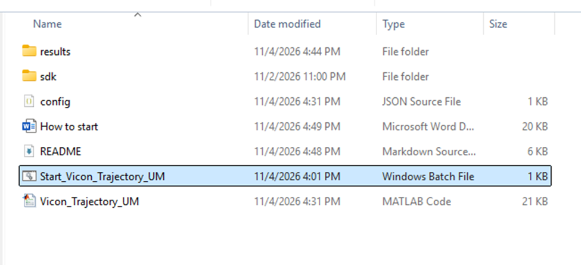
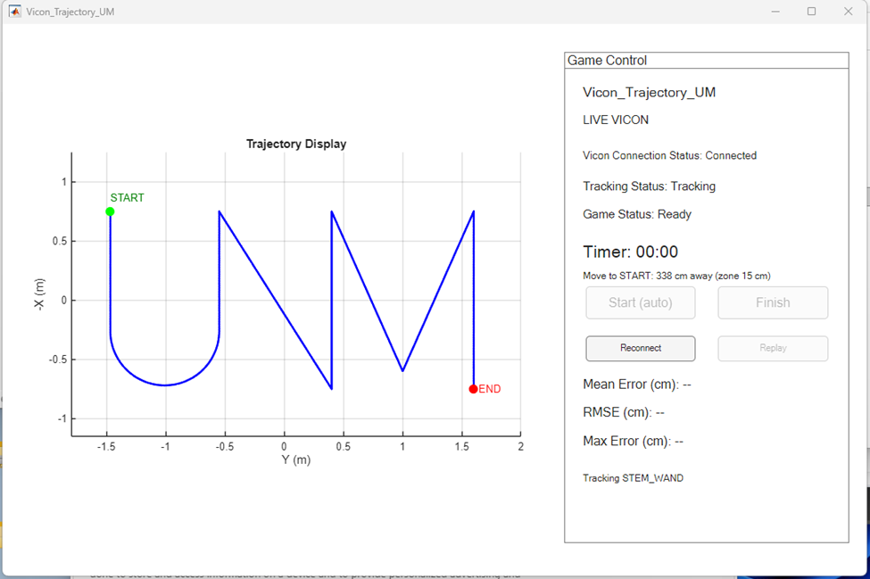
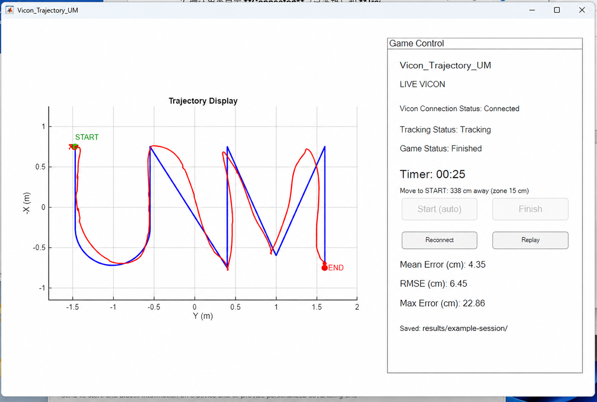

<h1 align="center">Vicon_Trajectory_UM</h1>

<p align="center"><strong>把动作捕捉，变成一场可以亲手体验的游戏。</strong></p>
<p align="center">手持反光球棒，沿着地面路线移动。<br>看自己的轨迹逐渐回放，再用数据了解走得有多准。</p>
<p align="center"><a href="README.md">English</a> · <strong>简体中文</strong></p>

<p align="center">
  
  
  
</p>

<p align="center">
  <a href="#有什么好玩">游戏亮点</a> · <a href="#看看怎么玩">玩法演示</a> ·
  <a href="#现在就试试">立即体验</a> · <a href="#在实验室使用">实验室部署</a> ·
  <a href="docs/SETUP.zh-CN.md">详细文档</a>
</p>

**Vicon_Trajectory_UM** 是一个基于 MATLAB 的轨迹跟随游戏，适合实验室演示和学生体验活动。手持带反光标记的球棒，沿着蓝色参考路线移动，Vicon 系统会记录运动轨迹。完成后，界面用红线回放你的运动过程，并显示三项距离误差。

**暂时没有 Vicon 设备？** 内置模拟模式，只需 Windows 电脑和 MATLAB 就能体验完整流程。

## 有什么好玩？

<table>
  <tr>
    <td width="50%" valign="top"><strong>🎯 走到起点，就能开玩</strong><br><br>进入起点区域，等待倒计时，然后沿路线移动。到达终点后自动结束，无需来回操作电脑。</td>
    <td width="50%" valign="top"><strong>▶️ 让运动过程重新出现</strong><br><br>按记录时的顺序和节奏回放轨迹。对比红色轨迹与蓝色参考线，也可以再次播放。</td>
  </tr>
  <tr>
    <td width="50%" valign="top"><strong>📏 把偏差变成看得懂的数据</strong><br><br>以厘米显示平均误差、均方根误差和最大误差。每轮保存数据与结果图片，方便回顾。</td>
    <td width="50%" valign="top"><strong>🧪 先体验，再连接设备</strong><br><br>默认开启模拟模式。连接硬件前，就能熟悉倒计时、记录、回放以及跟踪丢失时的表现。</td>
  </tr>
</table>

## 看看怎么玩

**靠近 START → 倒计时 → 沿路线移动 → 到达 END → 回放与查看结果**

1. **打开游戏。** 双击 `Start_Vicon_Trajectory_UM.bat`，等待 MATLAB 加载后出现游戏窗口。

   

2. **准备就绪。** 使用真实设备时，确认界面显示 **LIVE VICON**、**Connected** 和 **Tracking**。下载的项目默认使用 **SIMULATION MODE**。

   

3. **进入起点区域。** 将球棒的刚体原点保持在 **START 周围 15 cm 内**，**3 秒**倒计时后自动开始记录。离开区域或跟踪丢失会重置倒计时。

4. **沿蓝色路线移动。** 在跟踪有效的情况下，进入 **END 周围 15 cm 内**并保持 **0.3 秒**，本轮自动结束并开始回放。

5. **观看、对比，再来一次。** 查看红色轨迹和误差数值。点击 **Replay** 可再次回放；真实模式下回到 START 可开始下一轮，模拟模式下点击 **Reconnect** 可回到起点。

   

   <sub>第一张截图展示的是早期文件夹布局。结果示意图基于录制截图制作，其中保存路径经过 AI 编辑以保护隐私。</sub>

### 一轮游戏能告诉你什么？

| Mean Error · 平均误差 | RMSE · 均方根误差 | Max Error · 最大误差 |
| :--- | :--- | :--- |
| 平均偏离路线多远。 | 对较大偏差更敏感的整体误差指标。 | 偏离路线最远的一次距离。 |

三项指标均根据轨迹点到参考路线的最短距离计算，单位为 **cm**，数值越小表示越贴近路线。它们不检查行走顺序或是否走完每一段。跟踪丢失部分显示为断点，不参与误差计算。

每轮会在独立文件夹中保存 **CSV 采样数据**、**PNG 结果图片**和 **MAT 会话文件**，可以用于演示记录，也可以之后在 MATLAB 中分析。

## 现在就试试

**需要 Windows x64 和 MATLAB。** 项目开发与流程测试使用 MATLAB R2025b。

在 GitHub 点击 **Code → Download ZIP**，解压后双击 [Start_Vicon_Trajectory_UM.bat](Start_Vicon_Trajectory_UM.bat)。[config.json](config.json) 已默认开启模拟模式。

也可以在 MATLAB 中打开项目文件夹，然后运行：

```matlab
Vicon_Trajectory_UM
```

模拟球棒约 **20 秒**走完路线，另有倒计时和回放时间。过程中包含一小段模拟跟踪丢失，便于观察断点处理。结束后点击 **Reconnect** 可再次体验。

> [!TIP]
> 点击 **Finish** 可以提前结束记录。请等待回放完成再关闭窗口，以确保全部结果保存。关闭游戏也会退出由 BAT 启动的 MATLAB 会话。

## 在实验室使用

### 硬件

- 已完成标定、覆盖路线区域的 **Vicon 摄像机系统**，以及配套网络与供电设备。
- 带反光标记的**手持刚性球棒**，并在 Tracker 中定义为刚体。
- 按参考坐标布置在捕捉区域内的**地面路线标记**。
- 一台运行 MATLAB 的 Windows x64 电脑；若 Tracker 在另一台电脑上运行，两者需要网络互通。

### 软件

| 组件 | 项目使用环境 | 官方来源 |
| --- | --- | --- |
| MATLAB | **R2025b** | [MATLAB](https://www.mathworks.com/products/matlab.html) |
| Vicon Tracker | **3.10.0** | [Tracker](https://www.vicon.com/software/tracker/) |
| Vicon DataStream SDK | **1.11.0**，Windows x64 .NET 包 | [DataStream SDK](https://www.vicon.com/software/datastream-sdk/) |
| .NET Framework C# 编译器 | `Framework64\v4.0.30319\csc.exe` | 用于在本地编译采集适配器。 |

上述 Tracker 与 SDK 版本为维护者提供的硬件使用环境，其他组合尚未全面验证。官网可能展示更新版本；MATLAB 和 Vicon 软件需要单独安装。

### 切换到真实跟踪

1. 标定 Vicon 系统，建立球棒刚体，并在 Tracker 中启用 **DataStream 输出**。
2. 在 [config.json](config.json) 中将 `SIMULATION_MODE` 改为 `false`，检查 `VICON_SERVER`、`RIGID_BODY_NAME` 和 `SDK_DIR`。服务器与刚体名称默认分别为 `localhost` 和 `STEM_WAND`。
3. 重新启动，等待 **Connected** 和 **Tracking**。首次真实模式运行会自动编译 C# 适配器，项目文件夹需要可写。

> [!IMPORTANT]
> 检测使用的是**刚体原点**，不是球棒尖端。地面路线需要与 Vicon 全局 XY 坐标一致。界面显示为**横轴 Y / 纵轴 −X**，保存数据仍使用原始 XY 坐标；程序不自动对齐路线或补偿尖端偏移。

**[阅读完整设置指南 →](docs/SETUP.zh-CN.md)**

## 调整与深入了解

默认参数：起点半径 **15 cm**、倒计时 **3 秒**、终点半径 **15 cm**、终点保持时间 **0.3 秒**。修改 [config.json](config.json) 后重新启动即可生效。

| 我想要…… | 查看文档 |
| --- | --- |
| 安装依赖并连接 Tracker | [环境与安装](docs/SETUP.zh-CN.md#硬件与软件要求) |
| 布置或修改地面路线 | [真实设备设置与参考坐标](docs/SETUP.zh-CN.md#连接真实-vicon) |
| 调整检测、回放或模拟参数 | [配置说明](docs/SETUP.zh-CN.md#配置说明) |
| 了解时间戳和保存文件 | [数据导出](docs/SETUP.zh-CN.md#数据导出) |
| 找到各个源文件 | [项目结构](docs/SETUP.zh-CN.md#项目结构) |
| 处理连接或启动问题 | [常见问题](docs/SETUP.zh-CN.md#常见问题) |

游戏直接运行 MATLAB 源代码，无需 MATLAB Compiler、独立 MATLAB Runtime、Parallel Computing Toolbox 或 Python。生成的记录与适配器 DLL 已由 `.gitignore` 排除。
